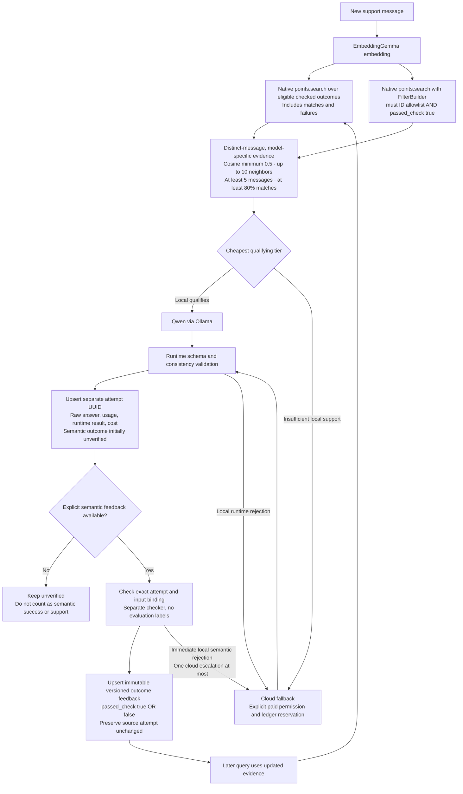

# Routing loop

The successful-outcome query proposes eligible successful tiers. The separate all-outcome query supplies the denominator, including failures. Unknown live outcomes supply neither successes nor reviewed support. Model choice, native neighbors, both checks, and cost are logged.

The bounded demonstration replays existing answers. Its checker compares the saved demo output with an existing synthetic draft reference in a separate offline process. That is disclosed draft-reference agreement, not independent human review or guaranteed correctness. Without an explicit check, a schema-valid answer or a cloud response stays unverified. Feedback does not guarantee a model switch or improved routing.

The database performs vector search and scoring. Native retrieval over-fetches to the collection point count with explicit search breadth, verifies expected IDs, and stops on incomplete results. No Python cosine ranking is used by this loop. See README.md for the bounded collection-size limitation.
