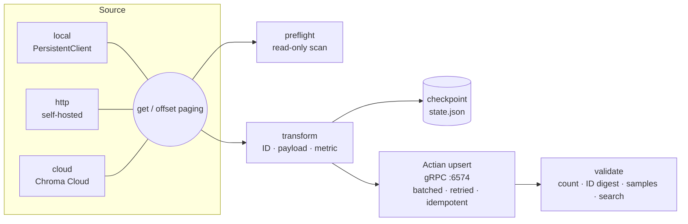

# chroma2actian

Migrate Chroma collections to **Actian VectorAI DB** (Docker): from a **local on-disk Chroma**, a **self-hosted Chroma server**, or **Chroma Cloud**. Your existing embeddings are reused (nothing is re-embedded).



## Install and start Actian

```bash
pip install -e .                    # Python >= 3.10
docker compose up -d                # read the EULA first; see comment in docker-compose.yml
```

## Quick start

```bash
# Chroma Cloud
export CHROMA_API_KEY=... CHROMA_TENANT=... CHROMA_DATABASE=...
chroma2actian preflight --source cloud --collection my_docs
chroma2actian migrate   --source cloud --collection my_docs

# Self-hosted Chroma server
chroma2actian migrate --source http --chroma-host chroma.internal --chroma-port 8000 --chroma-token $TOKEN --collection my_docs

# Local on-disk Chroma (copy the directory first; don't read a store another process is writing)
chroma2actian migrate --source local --chroma-path ./chroma --collection my_docs

# Everything in a database, with a prefix on the target names
chroma2actian migrate --source cloud --all-collections --target-prefix prod_
```

Target defaults to `localhost:6574`; override with `--actian-url host:6574`, `--actian-token`, `--actian-tls`
(or `ACTIAN_VECTORAI_*` env vars; the SDK reads them too). Use `--wait-for-target 60` right after `docker compose up`.

| Command | What it does | Writes? |
|---|---|---|
| `list` | collections, counts, distance space | no |
| `preflight` | scans every record; reports BLOCKING / WARNING / INFO findings → `preflight.json` | no |
| `migrate` | creates the target collection, streams, checkpoints, flushes, then validates (`--no-validate` to skip) | yes |
| `validate` | verifies an existing migration → `validation_report.json` | no |

Exit codes: `0` ok · `1` check failed / runtime failure · `2` usage or precondition · `3` interrupted (state saved; `--resume`).

## Runbook (what to do in production)

1. **Rehearse** on a copy or small collection. Time it to size your write pause.
2. `preflight` and read every finding.
3. **Pause writes** to Chroma. Offset paging is only consistent on a frozen collection; the run **fails** if the count changes mid-flight.
4. `migrate`. Ctrl-C / SIGTERM finishes the current page, saves the checkpoint, exits 3. Continue with `--resume`.
5. Read the validation report, then switch app reads **and** writes to Actian together (one config flag).
6. Keep the workdir (`state.json`, `migration_summary.json`, `rejected.jsonl`): it records the ID mapping settings.

## How data is mapped

| Chroma | Actian VectorAI DB |
|---|---|
| `ids` (strings) | point ID must be a non-negative int or UUID → default `uuid5(namespace, id)`; original kept in payload `chroma_id` |
| `embeddings` | the point's dense vector (float32); dimension fixed from the first record, checked on every record |
| `documents` | payload `document` (`--no-documents` to skip) |
| `metadatas` | top-level payload keys (nested values/arrays pass through) |
| distance `l2` / `cosine` / `ip` | `Euclid` / `Cosine` / `Dot` (`--distance` overrides) |
| tenant / database | not mapped: one Actian instance; use `--target-prefix` to namespace |

Key renames: a metadata key equal to `document` or `chroma_id` becomes `meta_<key>` (logged; fails the record on a collision). Integers outside int64 are stored as strings. `None` documents are omitted.

**ID strategies** (`--id-strategy`): `uuid5` (default, uniform) · `preserve` (canonical UUIDs and canonical ints kept, others → uuid5) · `numeric` (strict; every ID must be a canonical non-negative integer). Your app can recompute any ID: `chroma2actian.transform.map_id(chroma_id, strategy, namespace)`.

**Scores change meaning.** Chroma returns *distances* (lower = closer); Actian returns *scores*. Re-tune any thresholds in your app.

**Filters are not translated.** Chroma `where` / `where_document` queries must be rewritten with Actian's `Field` / `FilterBuilder`.

## Why validation is trustworthy

*ID-set check* uses an order-independent digest, O(1) memory at any scale:

```
H(S) = ( |S| ,  Σ h(id) mod 2^128 ,  ⊕ h(id) )      h = BLAKE2b-128 of the canonical ID string
```

Equal sets always match; different sets collide with probability ≈ 2⁻¹²⁸. Hashing first matters: summing raw IDs would let {1,4} and {2,3} collide. On a mismatch (and ≤ 2M records) it lists the missing / unexpected IDs.

Other checks: collection dimension + metric · `count == source − skipped` · a deterministic hash-sample of records compared field by field (cosine vectors are compared by direction because a server may store a normalised copy) · top-k overlap of Chroma `query()` vs Actian `search()` on **golden queries** (`--golden-queries file.jsonl` of `{"query_id","embedding"}` made with *your* embedding model) or, without a file, self-queries from sampled vectors. Overlap thresholds (mean ≥ 0.9, each ≥ 0.6) are heuristics: both engines are approximate.

## Options worth knowing

`--batch-size` (256) · `--workers` (4 parallel upserts per page) · `--page-size` (1000, or 100 for cloud; shrinks automatically on quota/size errors) · `--if-exists fail|reuse|recreate` (`recreate` needs `--yes`) · `--on-bad-record fail|skip` (skips go to `rejected.jsonl`, and validation accounts for them) · `--hnsw-m`, `--hnsw-ef-construct` · `--fresh` / `--resume`.

## Testing and honest limits

`pytest` runs 51 tests against **real local Chroma 1.5.9** and an **in-memory Actian stand-in that uses the real SDK 1.0.3 models/exceptions and serialises every point with the SDK's `to_proto()`**. It covers resume, idempotency, splitting, retries, capacity errors and damage detection.

**Not yet exercised:** a live Actian container and a live Chroma Cloud account (no access from the build environment). Run `ACTIAN_LIVE=1 pytest tests/test_live_actian.py` against your container, and rehearse against your real collection before the write pause.

Known limits: one pass reads by offset (cost can grow on very large collections); Chroma `where` filters are not translated; named/sparse/multi-vectors are not written; the Actian licence may cap vector count (the tool stops with a clear `CapacityError`).
